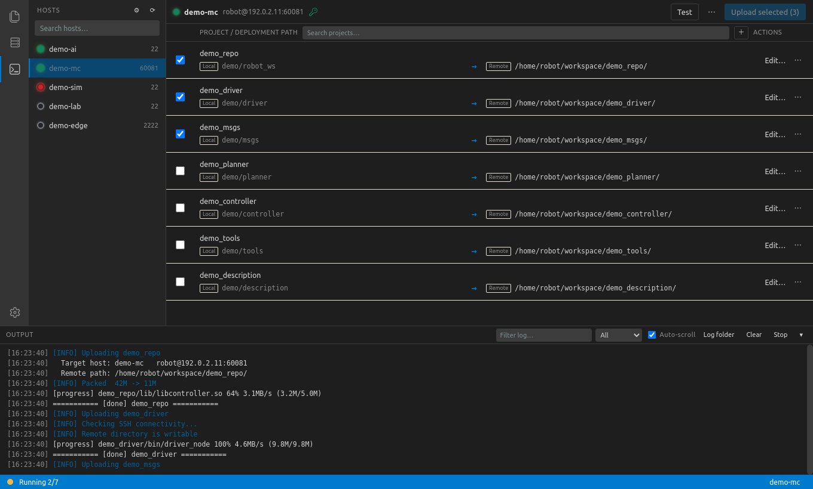

<div align="center">

# SCPro

**A VS Code–styled deployment console for robot software.**

Pick a host, tick the packages, press upload — SCPro packs only what matters,
verifies the target, and streams it over rsync.

[](https://www.python.org/)
[](https://riverbankcomputing.com/software/pyqt/)
[](#quick-start)
[](#license)

[English](README.md) · [简体中文](README.zh-CN.md)

</div>



## Why SCPro

Deploying a ROS 2 workspace by hand means keeping six paths, an SSH alias, a port,
a password and a list of `--exclude` flags in your head — and repeating the whole
ritual for every board. SCPro turns that into: **pick a host, tick projects, upload**.

- **One source of truth** — hosts come from `~/.ssh/config`, projects live in a single
  `projects.yaml`. No more copying paths between terminals.
- **Rule-based routing** — `*-mc` and `*-ai` hosts can land in different directories;
  the first matching rule wins, and you see the resolved remote path before uploading.
- **Safe by default** — remote deletion is opt-in, the remote directory is checked for
  write access *before* transfer, and local package paths are validated before cleanup.
- **Self-contained** — GUI, deploy engine and config templates ship together. Copy the
  folder anywhere and it still runs.

## Features

**Deployment**

- Serial queue with live log streaming, per-project success/failure summary and one-click
  retry of failed items
- Preflight checks: required commands, source directory, host rule match, remote write
  access
- Incremental upload via `rsync`; big files (> 10 MB by default) show percentage, speed,
  transferred size and ETA
- Stop sends `SIGTERM` to the whole process group, then `SIGKILL` after 5 s; a task that
  produces no output for 10 minutes is stopped automatically

**Hosts & projects**

- Host list synced from `~/.ssh/config`, with ignore patterns, port overrides and live
  online/offline status
- Wildcard target rules per project, with a hit preview in the editor
- HTML project editor: local source picker, remote directory name, ordered host rules,
  exclude profiles and a lazily expanded exclusion tree
- Drag to reorder projects; search projects and hosts; selection is remembered across
  restarts

**Look & feel**

- VS Code color themes and file icons, resolved from your own
  `~/.config/Code/User/settings.json` (falls back to a built-in light/dark palette)
- Frameless window with a self-drawn title bar, floating resize handles, system tray
- Chinese / English UI, switchable at runtime; logs, queue state and panel height persist

## How it works

```
┌──────────────────────────────┐
│ web/  (HTML · CSS · JS)      │  UI only — no build step
└───────────┬──────────────────┘
            │ scpro:// commands          ▲ window.scpro* callbacks
┌───────────▼──────────────────┐         │
│ main.py — Bridge             │─────────┘
│  queue · QProcess · logging  │
├──────────────────────────────┤
│ backend.py → deploy_core.py  │  config, hosts, projects, secrets
├──────────────────────────────┤
│ deploy/deploy_one.sh         │  pack → SSH check → rsync → cleanup
└──────────────────────────────┘
```

The GUI never implements deployment logic itself: it builds exactly the same command
line you would run in a terminal and streams its output back into the log panel.

## Quick start

```bash
git clone https://github.com/<your-org>/SCPro.git
cd SCPro

sudo apt install python3-pyqt5.qtwebengine python3-yaml rsync openssh-client
# optional: password-based SSH hosts need sshpass
sudo apt install sshpass

./main.py            # launch
./main.py --check    # print resolved hosts/projects without opening a window
```

Optional desktop integration:

```bash
./install.sh               # application menu entry
./install.sh --autostart   # also start on login
```

### First run

Real configuration is **never** committed. On first launch, `deploy/*.example.*` is copied
to the matching local files, which are listed in `.gitignore`:

| Local file | Template | Purpose |
| --- | --- | --- |
| `deploy/projects.yaml` | `projects.example.yaml` | Projects, host rules, exclude profiles |
| `deploy/deploy_config.yaml` | `deploy_config.example.yaml` | Current host, directory suffix, `workspace_root` |
| `deploy/deploy_secrets.yaml` | `deploy_secrets.example.yaml` | SSH passwords (created with mode `600`) |
| `deploy/ssh_config` | `ssh_config.example` | Mirror / fallback of `~/.ssh/config` |
| `deploy/robot_connections.yaml` | `robot_connections.example.yaml` | Legacy password-key mapping (optional) |

## Configuration

A project is a local directory plus one or more host rules:

```yaml
projects:
  demo_repo:
    local_src: "demo/robot_ws"        # relative to workspace_root, or absolute / ~
    remote_name: "demo_repo"          # target directory name
    targets:                          # first matching rule wins
      - match: "*-mc"
        base: "/home/robot/workspace"
        subdir: "."
      - match: "*-ai"
        base: "/home/robot/workspace"
        subdir: "."
    excludes:
      use: ros2_pkg                   # build/, log/, .git, caches ...
      add: ["*.deb"]
```

The resolved remote path is `<base>/<subdir>/<remote_name><suffix>/`, where the suffix
comes from `deploy_config.yaml` (`-` means none, empty means today's date).

### SSH config sync

Clicking the refresh button in the header:

| `~/.ssh/config` | Behaviour |
| --- | --- |
| exists | Used as the source of truth, then copied to `deploy/ssh_config` |
| missing | `deploy/ssh_config` initializes it (`~/.ssh` 0700, file 0600) |

`deploy/deploy_one.sh` follows the same priority, so the GUI and CLI always agree.
Override with `DEPLOY_SSH_CONFIG=/path/to/config` if needed.

## Command line

The deploy engine works without the GUI:

```bash
./deploy/deploy_one.sh demo_repo --host demo-mc --plan      # resolve only
./deploy/deploy_one.sh demo_repo --host demo-mc --dry-run   # preview, write nothing
./deploy/deploy_one.sh demo_repo --host demo-mc --pack-only # local package only
./deploy/deploy_one.sh demo_repo --host demo-mc --yes       # upload
```

| Flag | Meaning |
| --- | --- |
| `--host <alias>` | Target host (defaults to `current_host`) |
| `--plan` | Print resolved paths, do nothing |
| `--dry-run` | Preview local/remote changes |
| `--pack-only` | Build the local package only |
| `--skip-copy` | Upload an existing package |
| `--keep-package` | Keep the local package after upload |
| `--delete-remote` | Delete remote files missing locally (opt-in) |
| `--suffix <v>` / `--no-suffix` | Override the directory suffix |
| `--src <dir>` / `--dst <dir>` | Override source / package directory |
| `--yes` | Skip interactive confirmation |

## Project structure

```
SCPro/
├── main.py                  # window, title bar, tray, queue, scpro:// bridge
├── backend.py               # adapter between UI and deploy core
├── deploy_core.py           # config, hosts, projects, secrets (no Qt)
├── vscode_theme.py          # reads VS Code theme/icons into web/assets
├── install.sh               # desktop entry / autostart
├── scpro.svg                # app and tray icon
├── docs/                    # screenshots
├── deploy/
│   ├── deploy_one.sh        # deployment engine
│   ├── name_suffix.sh       # shared suffix rules
│   ├── local_src.sh         # shared source path rules
│   ├── rsync_progress.py    # big-file progress for rsync
│   └── *.example.*          # config templates (local copies are gitignored)
├── logs/                    # runtime logs, last 30 kept
├── upload_tmp/              # local packages, safe to clear
└── web/                     # HTML/CSS/JS UI
```

## Security notes

- Passwords are stored locally in `deploy/deploy_secrets.yaml` (mode `600`) and passed to
  `sshpass` through the `SSHPASS` environment variable, not through `argv`.
- Nothing secret is committed: local configs, secrets, logs, cached packages and settings
  are all ignored by `.gitignore`.
- `--delete-remote` is disabled by default and can only be enabled from Settings.
- When a host key changes, SCPro asks before removing the old entry and accepting the new one.

## Development

- `./main.py --check` prints the resolved host/project state — handy for debugging YAML.
- Logs are written to `logs/scpro_<timestamp>.log` and rotated to the last 30 files.
- There is no build step: edit `web/*` and restart the app.
- JS → Python uses the `scpro://` navigation scheme; Python → JS uses `runJavaScript`.
  No QWebChannel, no bundler, no Node toolchain.

## License

No license has been added yet. Until a `LICENSE` file is present, the code is
“all rights reserved”. If you plan to open-source it, MIT or Apache-2.0 is a good fit.

Third-party assets: the codicon font and icons come from Visual Studio Code (MIT);
file/folder icons are copied from the VS Code icon theme installed on the machine.
