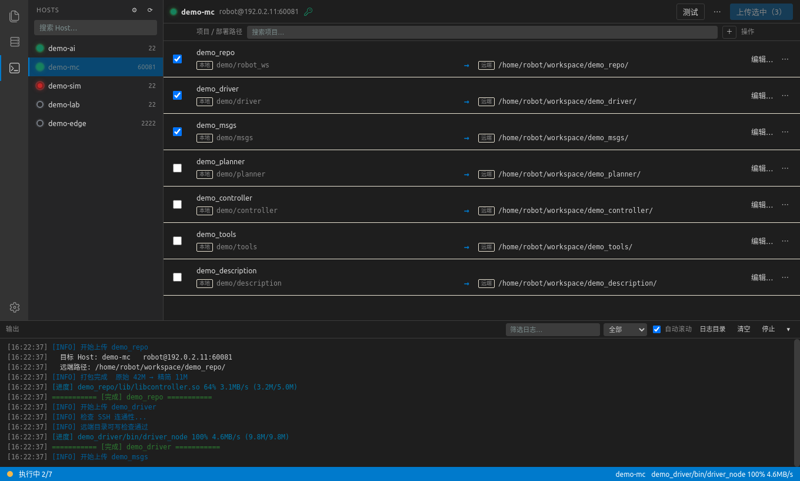

<div align="center">

# SCPro

**VS Code 风格的机器人代码部署控制台。**

选 Host、勾项目、点上传 —— SCPro 只打包该打包的内容，先检查目标机，
再用 rsync 传过去。

[](https://www.python.org/)
[](https://riverbankcomputing.com/software/pyqt/)
[](#快速开始)
[](LICENSE)

[English](README.md) · 简体中文

</div>



## 为什么用 SCPro

手动部署一个 ROS 2 工作区，意味着你要同时记住六个路径、一个 SSH 别名、一个端口、
一个密码和一堆 `--exclude` 参数，而且每块板子都要重来一遍。
SCPro 把它变成：**选 Host、勾项目、上传**。

- **单一事实来源** —— Host 来自 `~/.ssh/config`，项目集中在 `projects.yaml`，
  不用在终端之间复制粘贴路径。
- **按规则分发** —— `*-mc` 和 `*-ai` 可以落到不同目录，第一条命中的规则生效；
  上传前就能看到解析出的远端路径。
- **默认安全** —— 远端删除默认关闭；传输前先检查远端目录写权限；
  清理本地包之前校验路径，绝不动源码目录。
- **自包含** —— 界面、部署引擎和配置模板放在一起，整个目录可以单独拷走运行。

## 功能

**部署**

- 串行任务队列、实时日志、逐项成功/失败统计，失败的可以直接一键重试
- 预检：必需命令、源码目录、Host 规则命中、远端目录写权限
- `rsync` 增量上传；超过阈值（默认 10 MB）的文件显示百分比、速度、已传大小和剩余时间
- 停止时先向整个进程组发 `SIGTERM`，5 秒后 `SIGKILL`；连续 10 分钟无输出自动停止

**Host 与项目**

- Host 列表从 `~/.ssh/config` 同步，支持忽略名单、端口覆盖、在线/离线状态
- 侧栏可直接新增 / 删除 Host，改动写入 `~/.ssh/config`（自动备份 `.bak`）并同步项目副本
- 每个项目可配多条通配规则，编辑器里实时预览命中结果
- HTML 项目编辑器：选择源码目录、远端目录名、按顺序排列的 Host 规则、
  排除模板与按需展开的排除文件树
- 拖拽排序、Host/项目搜索、勾选状态跨重启记忆

**界面**

- 跟随本机 VS Code 配色与文件图标（读取 `~/.config/Code/User/settings.json`，
  读不到时回退内置浅色/深色配色）
- 无边框窗口 + 自绘标题栏 + 悬浮拉伸手柄 + 系统托盘
- 中英文界面运行时切换；日志、队列、面板高度都会持久化

## 工作原理

```
┌──────────────────────────────┐
│ web/  (HTML · CSS · JS)      │  纯界面，无构建步骤
└───────────┬──────────────────┘
            │ scpro:// 命令              ▲ window.scpro* 回调
┌───────────▼──────────────────┐         │
│ main.py — Bridge             │─────────┘
│  队列 · QProcess · 日志       │
├──────────────────────────────┤
│ backend.py → deploy_core.py  │  配置、Host、项目、密码
├──────────────────────────────┤
│ deploy/deploy_one.sh         │  打包 → SSH 检查 → rsync → 清理
└──────────────────────────────┘
```

界面本身不实现部署逻辑：它拼出的命令与你在终端手敲的完全一致，
再把子进程输出实时送回日志面板。

## 快速开始

```bash
git clone https://github.com/<your-org>/SCPro.git
cd SCPro

sudo apt install python3-pyqt5.qtwebengine python3-yaml rsync openssh-client
# 可选：使用密码认证的 Host 需要 sshpass
sudo apt install sshpass

./main.py            # 启动界面
./main.py --check    # 不开窗口，打印解析后的 Host / 项目
```

可选的桌面集成（便携安装）：

```bash
./install.sh               # 安装到应用菜单
./install.sh --autostart   # 同时开启开机自启
```

### 安装 deb 包

每次打 tag 发布时都会自动构建 `.deb`，从
[Releases](https://github.com/macitry/SCPro/releases) 下载后：

```bash
sudo apt install ./scpro_2.1.0_all.deb
scpro
```

程序安装到 `/usr/share/scpro`，用户数据分别放在
`~/.config/scpro`、`~/.local/state/scpro` 和 `~/.cache/scpro`。
打包与 PPA 流程见 [docs/PACKAGING.md](docs/PACKAGING.md)。

### 首次运行

真实配置**不会**进仓库。首次启动时把内置的 `*.example.*` 模板复制到当前配置目录
（便携模式是 `deploy/`，安装模式是 `~/.config/scpro`），这些副本都写进了 `.gitignore`：

| 配置文件 | 模板 | 用途 |
| --- | --- | --- |
| `projects.yaml` | `projects.example.yaml` | 项目、Host 规则、排除模板 |
| `deploy_config.yaml` | `deploy_config.example.yaml` | 当前 Host、目录后缀、`workspace_root` |
| `deploy_secrets.yaml` | `deploy_secrets.example.yaml` | SSH 密码（生成时权限 `600`） |
| `ssh_config` | `ssh_config.example` | `~/.ssh/config` 的镜像 / 兜底 |
| `robot_connections.yaml` | `robot_connections.example.yaml` | 老配置的密码键映射（可选） |

### 文件位置

| 模式 | 触发条件 | 配置 | 日志 | 缓存 |
| --- | --- | --- | --- | --- |
| 便携 | 程序目录可写（git clone、拷贝的文件夹） | `deploy/` | `logs/` | `upload_tmp/`、`web/assets/` |
| 安装 | 程序目录只读（deb 包） | `~/.config/scpro` | `~/.local/state/scpro/logs` | `~/.cache/scpro` |

支持 `XDG_CONFIG_HOME`、`XDG_STATE_HOME`、`XDG_CACHE_HOME`；
`SCPRO_PORTABLE=0` 或 `1` 可强制指定模式。

## 配置

一个项目 = 一个本地目录 + 若干条 Host 规则：

```yaml
projects:
  demo_repo:
    local_src: "demo/robot_ws"        # 相对 workspace_root，也可写绝对路径或 ~
    remote_name: "demo_repo"          # 远端目录名
    targets:                          # 按顺序匹配，第一条命中即用
      - match: "*-mc"
        base: "/home/robot/workspace"
        subdir: "."
      - match: "*-ai"
        base: "/home/robot/workspace"
        subdir: "."
    excludes:
      use: ros2_pkg                   # build/、log/、.git、缓存等
      add: ["*.deb"]
```

最终远端路径为 `<base>/<subdir>/<remote_name><后缀>/`，
后缀由 `deploy_config.yaml` 决定（`-` 表示不加，留空则用当天日期）。

### SSH 配置同步

点界面上的刷新按钮时：

| `~/.ssh/config` | 行为 |
| --- | --- |
| 存在 | 以它为准，并覆盖项目内 `deploy/ssh_config` |
| 不存在 | 用项目内 `deploy/ssh_config` 初始化它（`~/.ssh` 0700，文件 0600） |

`deploy/deploy_one.sh` 遵循同样的优先级，所以 GUI 和命令行看到的 Host 始终一致。
需要时可用 `DEPLOY_SSH_CONFIG=/path/to/config` 显式指定。

## 命令行

部署引擎可以脱离界面单独使用：

```bash
./deploy/deploy_one.sh demo_repo --host demo-mc --plan      # 只解析
./deploy/deploy_one.sh demo_repo --host demo-mc --dry-run   # 预演，不写文件
./deploy/deploy_one.sh demo_repo --host demo-mc --pack-only # 只做本地打包
./deploy/deploy_one.sh demo_repo --host demo-mc --yes       # 真正上传
```

| 参数 | 说明 |
| --- | --- |
| `--host <别名>` | 目标 Host（默认取 `current_host`） |
| `--plan` | 只打印解析结果 |
| `--dry-run` | 预演本地/远端变化 |
| `--pack-only` | 只生成本地包 |
| `--skip-copy` | 跳过打包，直接上传已有包 |
| `--keep-package` | 上传后保留本地包 |
| `--delete-remote` | 删除远端多余文件（默认关闭） |
| `--suffix <值>` / `--no-suffix` | 覆盖目录后缀 |
| `--src <目录>` / `--dst <目录>` | 覆盖源码 / 打包目录 |
| `--yes` | 跳过交互确认 |

## 目录结构

```
SCPro/
├── main.py                  # 窗口、标题栏、托盘、队列、scpro:// 桥
├── backend.py               # 界面与部署核心之间的适配层
├── deploy_core.py           # 配置、Host、项目、密码（无 Qt）
├── vscode_theme.py          # 读取 VS Code 主题/图标到 web/assets
├── install.sh               # 应用菜单 / 开机自启（便携安装）
├── scpro.svg                # 应用与托盘图标
├── LICENSE                  # MIT
├── debian/                  # Debian/Ubuntu 打包（不依赖 debhelper）
├── docs/                    # 截图、社交预览、打包说明
├── deploy/
│   ├── deploy_one.sh        # 部署引擎
│   ├── name_suffix.sh       # 公共后缀规则
│   ├── local_src.sh         # 公共源码路径规则
│   ├── rsync_progress.py    # 大文件进度
│   └── *.example.*          # 配置模板（本地副本已被 gitignore）
├── logs/                    # 运行日志，保留最近 30 份
├── upload_tmp/              # 本地打包目录，可随时清空
└── web/                     # HTML/CSS/JS 界面
```

## 安全说明

- 密码保存在本地 `deploy/deploy_secrets.yaml`（权限 `600`），运行时通过
  `SSHPASS` 环境变量交给 `sshpass`，不会出现在命令行参数里。
- 敏感内容不进仓库：本地配置、密码、日志、打包缓存、界面设置都被 `.gitignore` 排除。
- `--delete-remote` 默认关闭，只能在设置里显式开启。
- 主机密钥变更时会先确认，再删除旧记录并接受新密钥。

## 开发

- `./main.py --check` 打印解析后的 Host / 项目，排查 YAML 很方便。
- 日志写到 `logs/scpro_<时间戳>.log`，自动只保留最近 30 份。
- 没有构建步骤：改完 `web/*` 重启应用即可。
- JS → Python 走 `scpro://` 导航协议，Python → JS 用 `runJavaScript`；
  不需要 QWebChannel，也不需要 Node 工具链。
- 本地构建 deb：`dpkg-buildpackage -b -us -uc -d`（构建规则不依赖 debhelper）。

## 许可证

[MIT](LICENSE) © 2026 macitry。

第三方资源：codicon 字体与样式表来自 Visual Studio Code（MIT），详见
`debian/copyright`。folder/file 图标**不随包分发**——运行时从用户本机的
VS Code 图标主题生成。
